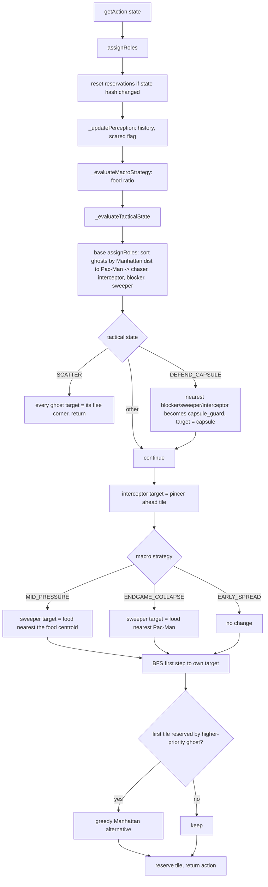

# Ghost Coordination Architecture

Written from the code as it stands on this branch (`multiagent/coordinatedGhostAgents.py`,
`multiagent/enhancedGhostAgents.py`). Line numbers refer to those files at the time of writing and
will drift. Measured behaviour is in `benchmarks/BASELINE.md`; where the code does not do what its
comments claim, this document says so.

## Components

```
                       pacman.py game loop  (ghost i is asked for getAction(state) once per tick,
                                             sequentially, each seeing the previous ghosts' moves)
                                |
        +-----------------------+------------------------+
        |                                                |
 CoordinatedGhostTeam (index)                 EnhancedCoordinatedGhostTeam (index)
   module-level singleton                       class-level singleton
        |                                                |
 GhostCoordinator  <---- subclass ----  EnhancedGhostCoordinator
   assignRoles()                          assignRoles()  (override, calls super())
   predictPacmanPosition()                predictPacmanPosition()  (velocity-based)
   findChokePoint()                       computePincerTargets()
   findSweepTarget()                      _updatePerception()
                                          _evaluateMacroStrategy()  _evaluateTacticalState()
                                          getFleeTarget()
                                          reserveTile() / isTileReservedByHigherPriority()
```

Each ghost agent is a thin client: on every `getAction` it asks the shared coordinator to
`assignRoles(state)`, reads `assignedTargets[self.index]`, runs a BFS to that target and returns the
first step. There is no message passing; "coordination" is that all four ghosts read one coordinator.
Because the coordinator is a process-wide singleton, **state leaks between games in one process**
(`initialFoodCount`, `pacmanHistory`, ...). The benchmark runs one game per subprocess and
`benchmarks/run_benchmark.reset_singletons()` clears them for in-process use.

## Per-tick data flow (Enhanced team)



## 1. Role allocation (`GhostCoordinator.assignRoles`, coordinatedGhostAgents.py:12)

Ghosts are sorted by Manhattan distance to Pac-Man. Nearest-first they get:

| rank | role | target |
|---|---|---|
| 1 | chaser | Pac-Man's tile |
| 2 | interceptor | `predictPacmanPosition()` |
| 3 | blocker | `findChokePoint()`: tile with <= 2 open neighbours maximising `(3-exits)*10/(dist+1)`, i.e. a nearby dead end or corridor tile |
| 4 | sweeper | `findSweepTarget()`: the food dot *farthest* from Pac-Man |

Roles are recomputed from scratch every call, so they are stateless and can flip between ticks as
ghosts move. Manhattan distance ignores walls, so "closest ghost" can be on the other side of a wall.

## 2. Trajectory prediction

* Base (`predictPacmanPosition`, line 42): takes the first non-STOP legal action, then repeats the same
  direction vector 4 times **without checking walls or moving the state**. It is not a prediction; the
  result can be inside a wall.
* Enhanced (enhancedGhostAgents.py:116): velocity = current position minus the position last seen by the
  coordinator; projects straight for 5 tiles, turning to the first non-reversing open neighbour at a
  wall (neighbour order E, W, N, S), reversing only in a dead end. Velocity is stale/zero on the first
  tick. Velocity is measured between coordinator calls (once per ghost, 4 per tick), but it only
  updates when the position changed, so it effectively tracks Pac-Man's last move.

## 3. Pincer (`computePincerTargets`, enhanced:208)

Walk from Pac-Man along its velocity up to 5 tiles or until a wall; that tile is the interceptor's
target, while the chaser targets Pac-Man itself. With zero velocity the most open adjacent tile is
used. This makes the interceptor ignore the base class's prediction entirely. Note it is a *straight
line* "ahead" tile, not a graph-aware choice of the exit Pac-Man will take at the next junction.

## 4. Path reservation (`reserveTile`, `isTileReservedByHigherPriority`)

Each ghost, after choosing its step, records the tile; later ghosts with *lower* role priority
(chaser 1 < interceptor 2 < blocker 3 < sweeper 4) avoid that tile via a greedy Manhattan
alternative. **Measured effectiveness: nil.** The table is cleared whenever
`(pacman_pos, ghost_positions)` changes, and in the real game loop the positions change after every
ghost move, so by the time ghost *k+1* asks, ghost *k*'s reservation has already been wiped. Across
24 instrumented games, `isTileReservedByHigherPriority` was called 4302 times and returned True 0 times.
(Ghosts still avoid stacking because the next ghost sees the real, updated positions in `state`.)

## 5. Tactical state machine (`_evaluateTacticalState`, enhanced:405)

Evaluated every call, no hysteresis, in strict priority order:

| state | trigger | behavioural effect |
|---|---|---|
| SCATTER | any ghost `scaredTimer > 0` | all targets := per-role corner (see 6) |
| DEFEND_CAPSULE | a capsule within Manhattan 4 of Pac-Man | nearest of blocker/sweeper/interceptor retargets to the capsule, role `capsule_guard` |
| TRAP_AMBUSH | Pac-Man's tile has <= 2 open neighbours | **none**: `assignRoles` has no branch for it |
| COORDINATED_HUNT | otherwise | default |

In 24 instrumented games TRAP_AMBUSH was the most frequent state (about 52% of evaluations) and does
nothing; the docstring's "interceptor locks down the forward choke" is not implemented beyond the
generic pincer. DEFEND_CAPSULE pulls a ghost away from the hunt towards a pellet; Manhattan "within
4" ignores walls.

Macro strategy (`_evaluateMacroStrategy`) only affects the sweeper:

| strategy | trigger (food left / initial) | sweeper target |
|---|---|---|
| EARLY_SPREAD | > 50% and > 5 dots | base: farthest food from Pac-Man |
| MID_PRESSURE | > 20% and > 5 dots | food nearest the food centroid |
| ENDGAME_COLLAPSE | otherwise | food nearest Pac-Man |

## 6. Scared coordination (`getFleeTarget`, enhanced:488)

When any ghost is scared, all ghosts flee (including ones that already respawned un-scared). Each
role has a fixed corner inset 2 tiles from the maze edge (chaser top-right, interceptor top-left,
blocker bottom-right, sweeper bottom-left); the target walks diagonally up to 3 steps to find a
non-wall tile, falling back to Pac-Man's tile (i.e. running *at* Pac-Man) if all four are walls.
Corners are fixed per role, not computed relative to Pac-Man, and roles are still re-ranked every tick
by distance to Pac-Man, so a ghost's corner can change tick to tick, causing dithering. The corner
BFS ignores Pac-Man, so a ghost can path through him.

## 7. Movement (`_bfsFirstAction`)

Plain BFS over the wall grid from each legal first step; returns the first action on the shortest
path, falling back to greedy Manhattan if unreachable. Only the first step is restricted to the engine's legal actions (ghosts may not reverse); later steps in the search are unrestricted, so the path can assume turns the ghost cannot make immediately. No ghost-ghost avoidance in the search. Cost is O(open tiles) per ghost
per tick; see `benchmarks/PROFILE.md`.

## Known weaknesses (all measured or directly visible in code)

1. Reservation never fires (section 4).
2. TRAP_AMBUSH is a no-op but is the dominant state (section 5).
3. `_updatePerception` computes the capsule-eaten flag and then immediately overwrites it with the
   scaredTimer check, so the "one tick early" detection claimed in comments does not exist.
4. Everything is recomputed per ghost per tick (4x redundant `assignRoles`, history appended 4x per
   tick, so `HISTORY_LEN = 6` covers about 1.5 ticks, not 6).
5. Manhattan distance used for role ranking, capsule threat and choke scoring.
6. Singleton coordinators leak state across games in one process.
7. Effectiveness: see `benchmarks/BASELINE.md`. The advanced features did not make the team stronger
   than the plain `CoordinatedGhostTeam` or `DirectionalGhost`.
