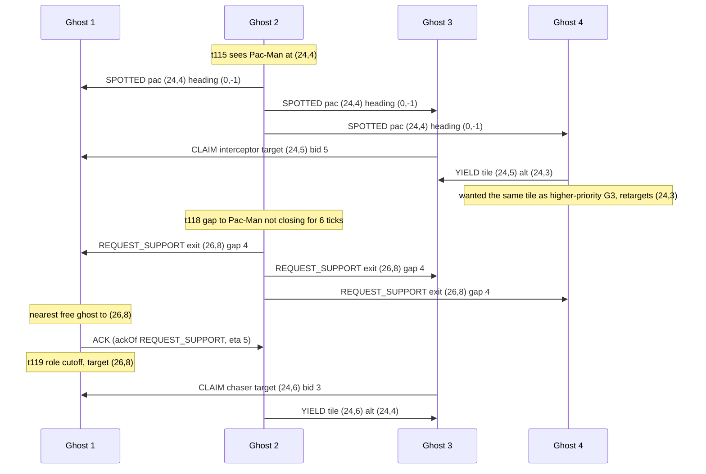

# Ghost messaging (Phase 10)

The Phase 3/4 teams are "coordinated" only in the sense that all four ghosts read one omniscient
coordinator object (`docs/ARCHITECTURE.md`). A message bus between them would add nothing, so to make
talking *necessary* this phase adds an opt-in **fog**: a ghost perceives Pac-Man only when he is within
6 maze tiles (`FOG_RADIUS`, env `GHOST_FOG_RADIUS`) or in straight line of sight along a corridor.
Otherwise it knows only what teammates tell it. Teammate positions and scared timers stay public (the
engine shows them to everyone); only Pac-Man is hidden.

Code: `multiagent/chatterGhostAgents.py` (nothing else in `multiagent/` was edited; helpers are imported
from `coordinatedGhostAgents.py`).

| Class (`-g ...`) | Fog | Bus |
|---|---|---|
| `EnhancedCoordinatedGhostTeam` (existing) | no, omniscient | none |
| `SilentFogGhostTeam` | yes | disabled - the control; same belief/role/target code |
| `ChatterGhostTeam` | yes | on |
| `LossyChatterGhostTeam` | yes | on, each delivery dropped with p = 0.5 (seeded) |

```
cd multiagent
python3 pacman.py -p GreedyAgent -g ChatterGhostTeam -l originalClassic -n 5 -q
```

## How a message works

`MessageBus` is created per game (`registerInitialState` replaces the hub, so `-n 5` and the
benchmark/dashboard reset paths are clean). A message is
`{id, tick, sender, to ('all' | ghost index), type, payload, ackOf}`; ids grow monotonically so delivery
order is send order, and loss uses a private seeded RNG, so a game is exactly reproducible.

**Delivery rule: a message is readable at the receiver's next decision after the send.** Ghosts act one
after another inside a tick, so ghost 1's message reaches ghosts 2-4 in the same tick and ghost 1 hears
ghosts 2-4 in the next tick. This is the lowest latency the sequential engine allows, needs no extra
buffering, and is deterministic. The price is a mild bias toward low ghost indices being heard
"sooner"; the same bias applies to the full-information team (it moves in index order too).

Memory is bounded: bus log 256 messages, inbox 16 per ghost, 64 messages per tick, claims table one
entry per teammate, gap history 8 entries. A 2000-tick run holds RSS flat (19.0 MB before and after;
`tests/test_chatter.py::test_2000_ticks_bounded`).

Each ghost keeps a **belief**: last observed Pac-Man tile, observation tick (so `age`), and heading.
It is refreshed by its own sight (heading read from Pac-Man's facing) and by any message carrying
`pac/heading/age` if the observation is newer. A belief up to 3 ticks old is hunted directly (projected
`age` steps along his heading); an older one switches the ghost to **search**: it spreads over tiles
reachable from the last sighting within `age` steps that it cannot currently sense, one seed tile per
searching ghost (farthest-point spread, nearest-ghost assignment), reusing `MazeDistances`.

## Protocol

| Type | Sender / trigger | Receiver | Payload | What the receiver does |
|---|---|---|---|---|
| `SPOTTED` | a ghost that senses Pac-Man, unless a teammate already reported him this/last tick; at most every 3 ticks unless his heading changed | all | `pac`, `heading`, `age` | Updates its belief if newer; a searching ghost leaves search mode and hunts the predicted tile |
| `CLAIM` | a ghost whose role/target changed or whose claim is 4 ticks old | all | `role`, `target`, `bid` | Stores it (TTL 8 ticks). When picking a role it skips any role a teammate holds with a better bid; interceptor/blocker/sweeper aim relative to the claimed chaser; searchers avoid tiles near another's search claim and drop ghosts that are already hunting from the search split. Replaces the old reservation table |
| `REQUEST_SUPPORT` | the chaser, when it has been within sight and has not closed the gap in 6 ticks (gap >= 3); at most every 10 ticks | all | `pac`, `heading`, `age`, `exit`, `gap` | The nearest free (unscared, non-requesting) ghost to `exit` replies `ACK` and switches to role `cutoff`, targeting `exit` for 8 ticks. Others ignore it |
| `ACK` | that nearest ghost | the requester | `exit`, `eta`, `ackOf` = request id | Requester stops re-requesting for 8 ticks |
| `HANDOFF` | the chaser, when a teammate is >= 2 tiles closer and Pac-Man is running toward it | that teammate | `pac`, `heading`, `age` | Becomes chaser for 6 ticks regardless of its own rank; the sender cannot reclaim the role for 6 ticks |
| `WARN_CAPSULE` | a ghost that senses Pac-Man within 5 maze tiles of a capsule; per capsule every 6 ticks | all | `cap`, `pac`, `heading`, `age` | The nearest unscared ghost that can reach the capsule no later than Pac-Man (preferring non-chasers) takes role `capsule_guard` for 6 ticks |
| `SCARED` | a scared ghost that senses Pac-Man (`event: scared`, every 3 ticks), or a ghost that was just eaten and respawned (`event: eaten`, position where it died) | all | `event`, `pac`, `heading`, `age`, `timer` | Updates belief; the nearest unscared ghost takes role `rescue` and goes to Pac-Man for 5 ticks |
| `YIELD` | a ghost whose target tile equals the target of a higher-priority ghost's claim | that ghost | `tile`, `alt` | The winner locks its current target for 4 ticks; the sender retargets to `alt`, the nearest tile (within 3) that is not the winner's and still within 6 of Pac-Man |

Role priority, highest first: chaser, capsule_guard, rescue, cutoff/interceptor, blocker, sweeper, search.
Bids are `maze distance to believed Pac-Man + 3 * belief age`, minus 2 for the incumbent of a role, so a
ghost that actually sees him outbids one working from stale information.

A scared ghost does not claim roles; it flees (`fleeAction`) from where it believes Pac-Man is.

## Telemetry and dashboard

`ChatterHub.getTelemetry()` (the object at `ChatterGhostTeam._coordinator`) returns the existing keys
(`tacticalState`, `macroStrategy`, `roles`, `targets`, `scaredTimers`) plus

* `messages`: every message sent in the current tick, `{id, tick, from, to, type, payload, ackOf?, lost?}`.
  It is read straight from the bus's send log; there is no display-only path. `lost` lists receivers a
  lossy bus dropped the delivery for.
* `beliefs`: `{ghost: {pacTile: [x, y] | null, age}}`
* `messageCounts`, `comms`, `fogRadius`, `tick`.

`dashboard/commander.read_coordinator` reads it without changes (tested), and `dashboard/record.py` /
`live.py` find the hub through `ghost_cls._coordinator` like for the other teams.

## A real exchange

Taken from the message log of `originalClassic`, `GreedyAgent`, seed 7000, `ChatterGhostTeam`
(ticks 115-120, all four ghosts; tile coordinates are maze tiles):



(The `to: all` rows are one bus message each, shown once per receiver. The exchange is the message
log, not a script: `tests/test_chatter.py` checks every message in telemetry has an id in the bus log,
and each type has an A/B test showing the receiver decides differently with and without it.)

ABLATION_PLACEHOLDER
