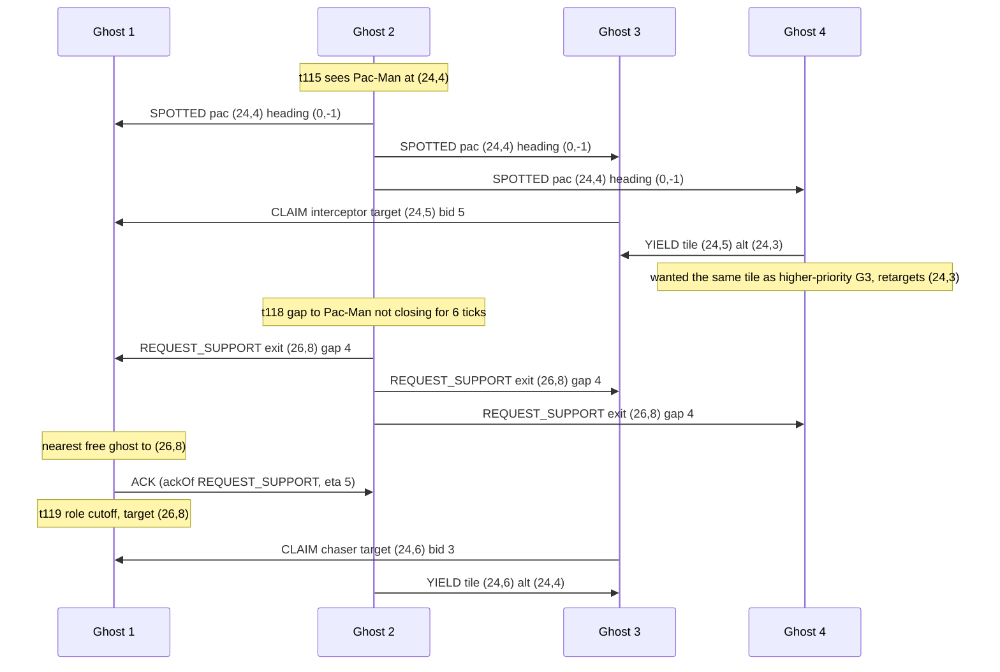

# Ghost messaging (Phase 10)

The Phase 3/4 teams are "coordinated" only in the sense that all four ghosts read one omniscient
coordinator object (`docs/ARCHITECTURE.md`). A message bus between them would add nothing, so to make
talking *necessary* this phase adds an opt-in **fog**: a ghost perceives Pac-Man only when he is within
6 maze tiles (`FOG_RADIUS`, env `GHOST_FOG_RADIUS`) or in straight line of sight along a corridor.
Otherwise it knows only what teammates tell it. Teammate positions and scared timers stay public (the
engine shows them to everyone); only Pac-Man is hidden.

Code: `multiagent/chatterGhostAgents.py` (nothing else in `multiagent/` was edited; helpers are imported
from `coordinatedGhostAgents.py`).

| Class (`-g ...`) | Fog | Bus |
|---|---|---|
| `EnhancedCoordinatedGhostTeam` (existing) | no, omniscient | none |
| `SilentFogGhostTeam` | yes | disabled - the control; same belief/role/target code |
| `ChatterGhostTeam` | yes | on |
| `LossyChatterGhostTeam` | yes | on, each delivery dropped with p = 0.5 (seeded) |

```
cd multiagent
python3 pacman.py -p GreedyAgent -g ChatterGhostTeam -l originalClassic -n 5 -q
```

## How a message works

`MessageBus` is created per game (`registerInitialState` replaces the hub, so `-n 5` and the
benchmark/dashboard reset paths are clean). A message is
`{id, tick, sender, to ('all' | ghost index), type, payload, ackOf}`; ids grow monotonically so delivery
order is send order, and loss uses a private seeded RNG, so a game is exactly reproducible.

**Delivery rule: a message is readable at the receiver's next decision after the send.** Ghosts act one
after another inside a tick, so ghost 1's message reaches ghosts 2-4 in the same tick and ghost 1 hears
ghosts 2-4 in the next tick. This is the lowest latency the sequential engine allows, needs no extra
buffering, and is deterministic. The price is a mild bias toward low ghost indices being heard
"sooner"; the same bias applies to the full-information team (it moves in index order too).

Memory is bounded: bus log 256 messages, inbox 16 per ghost, 64 messages per tick, claims table one
entry per teammate, gap history 8 entries. A 2000-tick run holds RSS flat (19.0 MB before and after;
`tests/test_chatter.py::test_2000_ticks_bounded`).

Each ghost keeps a **belief**: last observed Pac-Man tile, observation tick (so `age`), and heading.
It is refreshed by its own sight (heading read from Pac-Man's facing) and by any message carrying
`pac/heading/age` if the observation is newer. A belief up to 3 ticks old is hunted directly (projected
`age` steps along his heading); an older one switches the ghost to **search**: it spreads over tiles
reachable from the last sighting within `age` steps that it cannot currently sense, one seed tile per
searching ghost (farthest-point spread, nearest-ghost assignment), reusing `MazeDistances`.

## Protocol

| Type | Sender / trigger | Receiver | Payload | What the receiver does |
|---|---|---|---|---|
| `SPOTTED` | a ghost that senses Pac-Man, unless a teammate already reported him this/last tick; at most every 3 ticks unless his heading changed | all | `pac`, `heading`, `age` | Updates its belief if newer; a searching ghost leaves search mode and hunts the predicted tile |
| `CLAIM` | a ghost whose role/target changed or whose claim is 4 ticks old | all | `role`, `target`, `bid` | Stores it (TTL 8 ticks). When picking a role it skips any role a teammate holds with a better bid; interceptor/blocker/sweeper aim relative to the claimed chaser; searchers avoid tiles near another's search claim and drop ghosts that are already hunting from the search split. Replaces the old reservation table |
| `REQUEST_SUPPORT` | the chaser, when it has been within sight and has not closed the gap in 6 ticks (gap >= 3); at most every 10 ticks | all | `pac`, `heading`, `age`, `exit`, `gap` | The nearest free (unscared, non-requesting) ghost to `exit` replies `ACK` and switches to role `cutoff`, targeting `exit` for 8 ticks. Others ignore it |
| `ACK` | that nearest ghost | the requester | `exit`, `eta`, `ackOf` = request id | Requester stops re-requesting for 8 ticks |
| `HANDOFF` | the chaser, when a teammate is >= 2 tiles closer and Pac-Man is running toward it | that teammate | `pac`, `heading`, `age` | Becomes chaser for 6 ticks regardless of its own rank; the sender cannot reclaim the role for 6 ticks |
| `WARN_CAPSULE` | a ghost that senses Pac-Man within 5 maze tiles of a capsule; per capsule every 6 ticks | all | `cap`, `pac`, `heading`, `age` | The nearest unscared ghost that can reach the capsule no later than Pac-Man (preferring non-chasers) takes role `capsule_guard` for 6 ticks |
| `SCARED` | a scared ghost that senses Pac-Man (`event: scared`, every 3 ticks), or a ghost that was just eaten and respawned (`event: eaten`, position where it died) | all | `event`, `pac`, `heading`, `age`, `timer` | Updates belief; the nearest unscared ghost takes role `rescue` and goes to Pac-Man for 5 ticks |
| `YIELD` | a ghost whose target tile equals the target of a higher-priority ghost's claim | that ghost | `tile`, `alt` | The winner locks its current target for 4 ticks; the sender retargets to `alt`, the nearest tile (within 3) that is not the winner's and still within 6 of Pac-Man |

Role priority, highest first: chaser, capsule_guard, rescue, cutoff/interceptor, blocker, sweeper, search.
Bids are `maze distance to believed Pac-Man + 3 * belief age`, minus 2 for the incumbent of a role, so a
ghost that actually sees him outbids one working from stale information.

A scared ghost does not claim roles; it flees (`fleeAction`) from where it believes Pac-Man is.

## Telemetry and dashboard

`ChatterHub.getTelemetry()` (the object at `ChatterGhostTeam._coordinator`) returns the existing keys
(`tacticalState`, `macroStrategy`, `roles`, `targets`, `scaredTimers`) plus

* `messages`: every message sent in the current tick, `{id, tick, from, to, type, payload, ackOf?, lost?}`.
  It is read straight from the bus's send log; there is no display-only path. `lost` lists receivers a
  lossy bus dropped the delivery for.
* `beliefs`: `{ghost: {pacTile: [x, y] | null, age}}`
* `messageCounts`, `comms`, `fogRadius`, `tick`.

`dashboard/commander.read_coordinator` reads it without changes (tested), and `dashboard/record.py` /
`live.py` find the hub through `ghost_cls._coordinator` like for the other teams.

## A real exchange

Taken from the message log of `originalClassic`, `GreedyAgent`, seed 7000, `ChatterGhostTeam`
(ticks 115-120, all four ghosts; tile coordinates are maze tiles):



(The `to: all` rows are one bus message each, shown once per receiver. The exchange is the message
log, not a script: `tests/test_chatter.py` checks every message in telemetry has an id in the bus log,
and each type has an A/B test showing the receiver decides differently with and without it.)

## Ablation

Command (about 1 minute; Expectimax cells are deterministic and replay one game):

```
tools/capped -m 4G -- python3 benchmarks/chatter_ablation.py --games 100
```

mediumClassic and originalClassic, `GreedyAgent` and `ExpectimaxAgent` depth 2, seeds 7000-7099, fog radius 6,
Pac-Man move cap 1500. Raw per-game data: `benchmarks/results/chatter_ablation.json`. **Lower Pac-Man score
and shorter kill time = better ghosts.** "d vs silent" is the paired difference of Pac-Man's score
(chatter minus silent, same seeds); negative means communication helped the ghosts. CIs are
1.96 * sd / sqrt(n). Kill time is the Pac-Man move on which he died, averaged over games where he died
("-" = never killed within the cap). Note `mediumClassic` has only **2** ghosts; `originalClassic` has 4.

| Pac-Man | Layout | Ghosts | n (failed) | Score mean +/- 95% CI | d vs silent (paired) | Kill time +/- CI | Win % | Distinct scores | Msgs/game | Msgs/move | ms/decision |
|---|---|---|---|---|---|---|---|---|---|---|---|
| GreedyAgent | mediumClassic | full | 100 (0) | -257 +/- 49 | -33 +/- 56 | 25.4 +/- 4.7 | 0 | 35 | 0 | 0.00 | 0.10 |
| GreedyAgent | mediumClassic | silent | 100 (0) | -224 +/- 63 | - | 27.6 +/- 6.0 | 0 | 36 | 0 | 0.00 | 0.08 |
| GreedyAgent | mediumClassic | chatter | 100 (0) | -261 +/- 50 | -36 +/- 32 | 25.3 +/- 5.2 | 0 | 35 | 29 | 1.18 | 0.09 |
| GreedyAgent | mediumClassic | lossy | 100 (0) | -231 +/- 56 | -7 +/- 36 | 28.0 +/- 5.3 | 0 | 38 | 33 | 1.17 | 0.08 |
| GreedyAgent | originalClassic | full | 100 (0) | -58 +/- 83 | -93 +/- 98 | 37.8 +/- 6.3 | 0 | 37 | 0 | 0.00 | 0.24 |
| GreedyAgent | originalClassic | silent | 100 (0) | 35 +/- 83 | - | 76.0 +/- 13.6 | 0 | 58 | 0 | 0.00 | 0.15 |
| GreedyAgent | originalClassic | chatter | 100 (0) | 49 +/- 74 | +14 +/- 93 | 66.2 +/- 8.4 | 0 | 69 | 99 | 1.66 | 0.12 |
| GreedyAgent | originalClassic | lossy | 100 (0) | 28 +/- 76 | -7 +/- 77 | 73.2 +/- 10.9 | 0 | 64 | 121 | 1.85 | 0.13 |
| ExpectimaxAgent:2 | mediumClassic | full | 100 (0) | 153 +/- 0 | +723 +/- 0 | 37.0 +/- 0.0 | 0 | 1 | 0 | 0.00 | 0.19 |
| ExpectimaxAgent:2 | mediumClassic | silent | 100 (0) | -570 +/- 0 | - | - | 0 | 1 | 0 | 0.00 | 0.06 |
| ExpectimaxAgent:2 | mediumClassic | chatter | 100 (0) | 45 +/- 0 | +615 +/- 0 | 45.0 +/- 0.0 | 0 | 1 | 57 | 1.27 | 0.08 |
| ExpectimaxAgent:2 | mediumClassic | lossy | 100 (0) | 204 +/- 0 | +774 +/- 0 | 86.0 +/- 0.0 | 0 | 1 | 101 | 1.17 | 0.08 |
| ExpectimaxAgent:2 | originalClassic | full | 100 (0) | -296 +/- 0 | -1400 +/- 0 | 26.0 +/- 0.0 | 0 | 1 | 0 | 0.00 | 0.13 |
| ExpectimaxAgent:2 | originalClassic | silent | 100 (0) | 1104 +/- 0 | - | 186.0 +/- 0.0 | 0 | 1 | 0 | 0.00 | 0.24 |
| ExpectimaxAgent:2 | originalClassic | chatter | 100 (0) | 1593 +/- 0 | +489 +/- 0 | 187.0 +/- 0.0 | 0 | 1 | 328 | 1.75 | 0.10 |
| ExpectimaxAgent:2 | originalClassic | lossy | 100 (0) | 1643 +/- 0 | +539 +/- 0 | 227.0 +/- 0.0 | 0 | 1 | 391 | 1.72 | 0.10 |

Message mix per game (Greedy, originalClassic, chatter): CLAIM 70.5, SPOTTED 14.9, YIELD 6.6, SCARED 5.0,
WARN_CAPSULE 0.9, REQUEST_SUPPORT 0.4, ACK 0.3, HANDOFF 0. Cost: 0.09-0.13 ms per ghost decision with the
bus on, below the full-information team (0.10-0.24 ms) because the fog teams do no per-tick role sort.

### What the numbers say

The hypothesis "fog hurts, communication recovers most of it" is only partly supported, and not reliably.

* **Greedy, mediumClassic (2 ghosts):** fog costs little (silent -224 vs full -257, inside the noise).
  Chatter reaches -261, i.e. the full-information level, a paired gain of 36 +/- 32 points over silent
  (marginal). Lossy chatter gives back most of it (-7 +/- 36).
* **Greedy, originalClassic (4 ghosts):** fog hurts (+93 +/- 98 against full, kills take 76 moves instead of 38).
  Chatter does **not** recover it: +14 +/- 93 against silent, kill time 66 vs 76 (inside the CI).
* **Expectimax depth 2:** all teams are deterministic, so each cell is one game, not 100 (the "Distinct
  scores = 1" column; the CI of 0 is not evidence). On mediumClassic silent ghosts never kill him in
  1500 moves while chatter kills at move 45 (full: 37), which is the one clear communication win.
  On originalClassic chatter is no better than silent (kills at 187 vs 186, Pac-Man score higher).

Overall: communication helps where the map is small and the team is two ghosts, and does nothing
measurable on the 4-ghost map where fog hurts most. Three effects are reasonable explanations but were
**not** isolated: (1) with radius 6 plus line of sight, usually 2-3 ghosts already see Pac-Man when any
does, so beliefs mostly agree and SPOTTED adds information only for the far ghost; (2) role choice is
the same rank-by-distance rule in all conditions, so CLAIM mainly confirms what the rank rule already
gives; (3) HANDOFF never fired, because the rank rule already makes the nearest ghost the chaser.

### A bug the ablation found

The first version of `YIELD` replaced a contested pincer tile by any tile >= 3 from the winner's. On
mediumClassic/Greedy that made chatter *worse* than silent (-150 vs -224, +74 +/- 82). Leaving single
message types out (`--conditions chatter-noYIELD`, env `GHOST_MSG_OFF=YIELD,...`) isolated it: without
YIELD chatter scored -258. YIELD now fires only when two ghosts target the identical tile and the
loser picks the nearest alternative within 3 tiles that keeps it near Pac-Man. After that fix, the
leave-one-out runs (100 games) showed no other type hurting: no REQUEST_SUPPORT/ACK -265, no
WARN_CAPSULE/SCARED -254, no CLAIM -235, no HANDOFF -258 (all with YIELD off, vs -258 with all of them,
all within CI), i.e. the other types were neutral on this cell. The leave-one-out runs were made
before the final fix; only YIELD changed afterward.

## Honest limits

* Expectimax cells are a single deterministic game each; no statistical claim can be made from them.
* Fog parameters (radius 6, belief freshness 3, TTLs 8/6/4) were set once and not tuned; a smaller
  radius would make communication matter more, and was not tested.
* Teammate positions are public. Real ghosts with radios would not know each other's tiles either.
* HANDOFF is effectively redundant with the rank rule; YIELD is the weakest message (the winner only
  locks its target); WARN_CAPSULE and SCARED are rare (about 1 and 5 per game).
* `mediumClassic` has 2 ghosts, so REQUEST_SUPPORT/BLOCKER/SWEEPER roles barely exist there.
* The Pac-Man score mixes food and survival time; against Expectimax, a long game with few kills can
  look good for Pac-Man for reasons unrelated to ghost quality. Kill time is the cleaner signal.
* The silent control still avoids stepping on teammates and shares positions; it is a strong control,
  which makes "communication helps" harder to show, deliberately.

